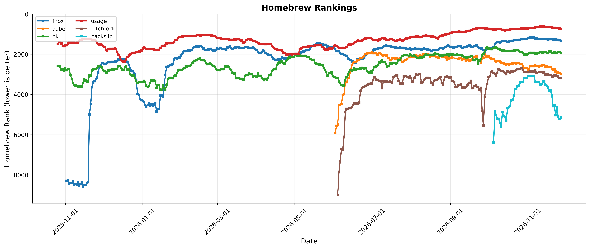
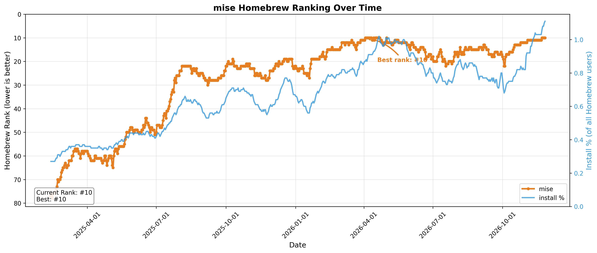

# mise Analytics

## Upcoming Crossovers

<!-- START upcoming-crossovers -->

| Project | Competitor | Expected Crossover | Days Until | lead gain (stars/day) |
| --- | --- | --- | --- | --- |
| mise | just | 2026-12-06 | 17 | 25.5 |
| mise | brew | 2028-04-12 | 510 | 27.9 |
| aube | berry | 2030-07-23 | 1342 | 4.5 |

<!-- END upcoming-crossovers -->

## mise Stats

## fnox Stats

## hk Stats

## aube Stats

## Top Repos Stats

## Top Repos Downloads

## Homebrew Rankings

## mise Homebrew Ranking

## Fastest Growing jdx Repos (30 Days)

<!-- START fastest-growing -->

Data window: 2026-10-20 → 2026-11-18 (UTC)

| Date | mise | mr-boxington | fnox | jactionlint | hk |
| --- | --- | --- | --- | --- | --- |
| 2026-10-20 | 35,190 | 530 | 2,292 | 270 | 1,274 |
| 2026-10-21 | 35,225 (+35) | 533 (+3) | 2,295 (+3) | 275 (+5) | 1,275 (+1) |
| 2026-10-22 | 35,254 (+29) | 549 (+16) | 2,296 (+1) | 275 (+0) | 1,275 (+0) |
| 2026-10-23 | 35,290 (+36) | 575 (+26) | 2,299 (+3) | 276 (+1) | 1,276 (+1) |
| 2026-10-24 | 35,319 (+29) | 587 (+12) | 2,303 (+4) | 281 (+5) | 1,278 (+2) |
| 2026-10-25 | 35,349 (+30) | 596 (+9) | 2,307 (+4) | 283 (+2) | 1,280 (+2) |
| 2026-10-26 | 35,382 (+33) | 598 (+2) | 2,314 (+7) | 287 (+4) | 1,283 (+3) |
| 2026-10-27 | 35,440 (+58) | 610 (+12) | 2,319 (+5) | 294 (+7) | 1,287 (+4) |
| 2026-10-28 | 35,477 (+37) | 621 (+11) | 2,321 (+2) | 295 (+1) | 1,287 (+0) |
| 2026-10-29 | 35,516 (+39) | 632 (+11) | 2,323 (+2) | 296 (+1) | 1,289 (+2) |
| 2026-10-30 | 35,555 (+39) | 636 (+4) | 2,336 (+13) | 298 (+2) | 1,292 (+3) |
| 2026-10-31 | 35,576 (+21) | 641 (+5) | 2,342 (+6) | 302 (+4) | 1,293 (+1) |
| 2026-11-01 | 35,601 (+25) | 652 (+11) | 2,345 (+3) | 304 (+2) | 1,294 (+1) |
| 2026-11-02 | 35,678 (+77) | 671 (+19) | 2,353 (+8) | 308 (+4) | 1,297 (+3) |
| 2026-11-03 | 35,718 (+40) | 681 (+10) | 2,354 (+1) | 311 (+3) | 1,299 (+2) |
| 2026-11-04 | 35,766 (+48) | 688 (+7) | 2,357 (+3) | 312 (+1) | 1,301 (+2) |
| 2026-11-05 | 35,766 (+0) | 688 (+0) | 2,357 (+0) | 312 (+0) | 1,301 (+0) |
| 2026-11-06 | 35,857 (+91) | 712 (+24) | 2,361 (+4) | 316 (+4) | 1,303 (+2) |
| 2026-11-07 | 35,894 (+37) | 714 (+2) | 2,361 (+0) | 317 (+1) | 1,304 (+1) |
| 2026-11-08 | 35,930 (+36) | 718 (+4) | 2,365 (+4) | 318 (+1) | 1,306 (+2) |
| 2026-11-09 | 35,930 (+0) | 718 (+0) | 2,365 (+0) | 318 (+0) | 1,306 (+0) |
| 2026-11-10 | 36,005 (+75) | 743 (+25) | 2,373 (+8) | 324 (+6) | 1,310 (+4) |
| 2026-11-11 | 36,041 (+36) | 745 (+2) | 2,379 (+6) | 328 (+4) | 1,312 (+2) |
| 2026-11-12 | 36,075 (+34) | 751 (+6) | 2,379 (+0) | 332 (+4) | 1,313 (+1) |
| 2026-11-13 | 36,102 (+27) | 762 (+11) | 2,385 (+6) | 336 (+4) | 1,316 (+3) |
| 2026-11-14 | 36,135 (+33) | 765 (+3) | 2,387 (+2) | 335 (-1) | 1,317 (+1) |
| 2026-11-15 | 36,173 (+38) | 772 (+7) | 2,390 (+3) | 337 (+2) | 1,319 (+2) |
| 2026-11-16 | 36,212 (+39) | 776 (+4) | 2,397 (+7) | 340 (+3) | 1,321 (+2) |
| 2026-11-17 | 36,242 (+30) | 778 (+2) | 2,402 (+5) | 344 (+4) | 1,337 (+16) |
| 2026-11-18 | 36,284 (+42) | 779 (+1) | 2,407 (+5) | 345 (+1) | 1,343 (+6) |

- `mise` grew by +1,094 stars
- `mr-boxington` grew by +249 stars
- `fnox` grew by +115 stars
- `jactionlint` grew by +75 stars
- `hk` grew by +69 stars

<!-- END fastest-growing -->
