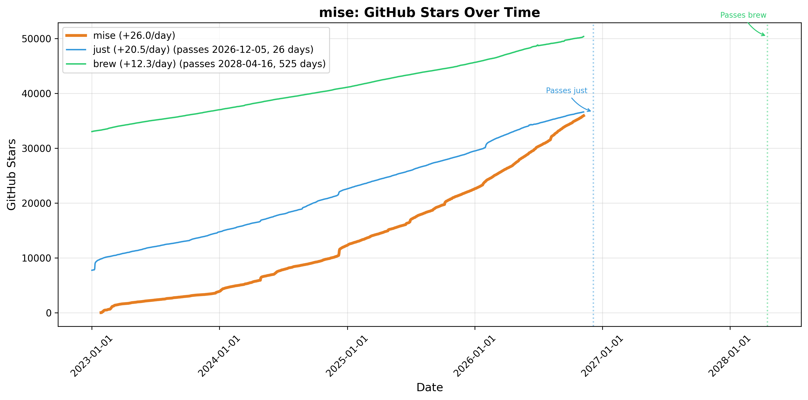
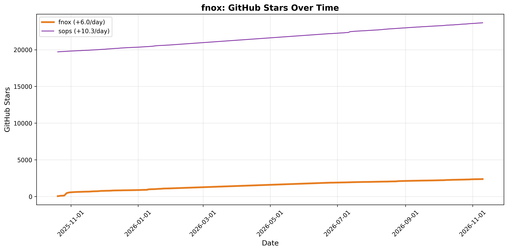
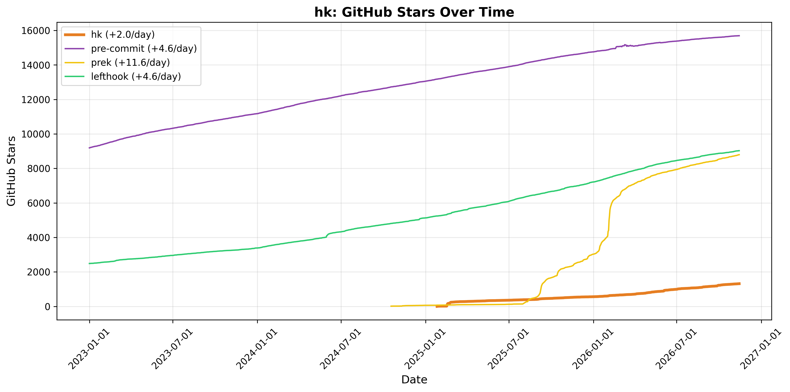
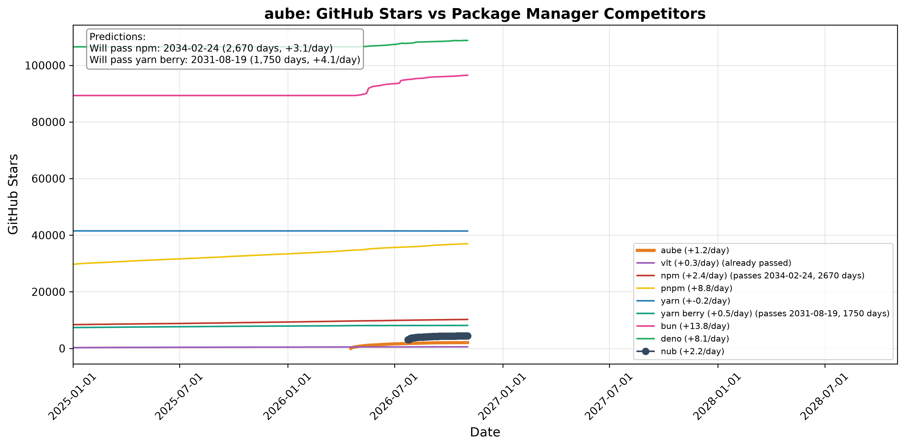
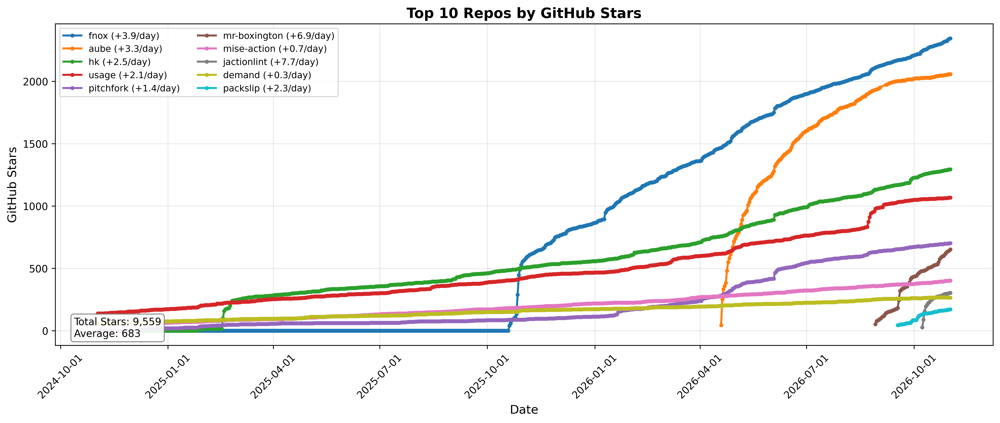
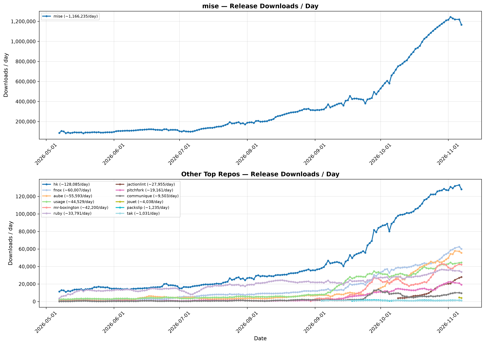
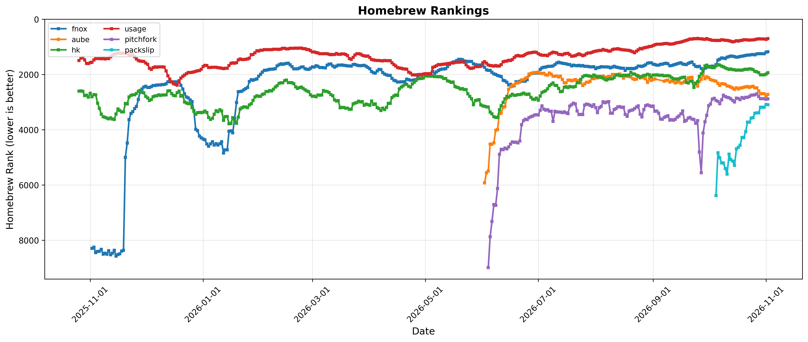
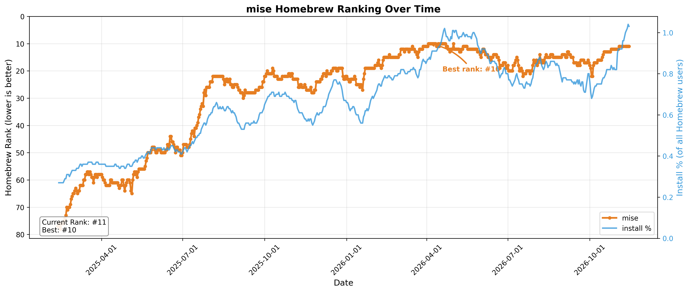

# mise Analytics

## Upcoming Crossovers

<!-- START upcoming-crossovers -->

| Project | Competitor | Expected Crossover | Days Until | lead gain (stars/day) |
| --- | --- | --- | --- | --- |
| mise | just | 2026-12-05 | 28 | 24.9 |
| mise | brew | 2028-04-11 | 520 | 28.0 |
| aube | berry | 2032-04-06 | 1976 | 3.7 |
| aube | npm | 2035-03-26 | 3060 | 2.7 |

<!-- END upcoming-crossovers -->

## mise Stats

## fnox Stats

## hk Stats

## aube Stats

## Top Repos Stats

## Top Repos Downloads

## Homebrew Rankings

## mise Homebrew Ranking

## Fastest Growing jdx Repos (30 Days)

<!-- START fastest-growing -->

Data window: 2026-10-09 → 2026-11-07 (UTC)

| Date | mise | mr-boxington | jactionlint | fnox | packslip |
| --- | --- | --- | --- | --- | --- |
| 2026-10-09 | 34,807 | 481 | 87 | 2,250 | 136 |
| 2026-10-10 | 34,862 (+55) | 483 (+2) | 155 (+68) | 2,254 (+4) | 136 (+0) |
| 2026-10-11 | 34,895 (+33) | 488 (+5) | 193 (+38) | 2,257 (+3) | 137 (+1) |
| 2026-10-12 | 34,927 (+32) | 494 (+6) | 207 (+14) | 2,261 (+4) | 137 (+0) |
| 2026-10-13 | 34,952 (+25) | 503 (+9) | 222 (+15) | 2,270 (+9) | 139 (+2) |
| 2026-10-14 | 34,981 (+29) | 505 (+2) | 226 (+4) | 2,273 (+3) | 139 (+0) |
| 2026-10-15 | 35,024 (+43) | 508 (+3) | 241 (+15) | 2,277 (+4) | 142 (+3) |
| 2026-10-16 | 35,057 (+33) | 513 (+5) | 247 (+6) | 2,280 (+3) | 144 (+2) |
| 2026-10-17 | 35,099 (+42) | 517 (+4) | 257 (+10) | 2,281 (+1) | 145 (+1) |
| 2026-10-18 | 35,120 (+21) | 524 (+7) | 260 (+3) | 2,285 (+4) | 149 (+4) |
| 2026-10-19 | 35,144 (+24) | 527 (+3) | 265 (+5) | 2,290 (+5) | 151 (+2) |
| 2026-10-20 | 35,190 (+46) | 530 (+3) | 270 (+5) | 2,292 (+2) | 152 (+1) |
| 2026-10-21 | 35,225 (+35) | 533 (+3) | 275 (+5) | 2,295 (+3) | 154 (+2) |
| 2026-10-22 | 35,254 (+29) | 549 (+16) | 275 (+0) | 2,296 (+1) | 159 (+5) |
| 2026-10-23 | 35,290 (+36) | 575 (+26) | 276 (+1) | 2,299 (+3) | 159 (+0) |
| 2026-10-24 | 35,319 (+29) | 587 (+12) | 281 (+5) | 2,303 (+4) | 160 (+1) |
| 2026-10-25 | 35,349 (+30) | 596 (+9) | 283 (+2) | 2,307 (+4) | 160 (+0) |
| 2026-10-26 | 35,382 (+33) | 598 (+2) | 287 (+4) | 2,314 (+7) | 161 (+1) |
| 2026-10-27 | 35,440 (+58) | 610 (+12) | 294 (+7) | 2,319 (+5) | 163 (+2) |
| 2026-10-28 | 35,477 (+37) | 621 (+11) | 295 (+1) | 2,321 (+2) | 164 (+1) |
| 2026-10-29 | 35,516 (+39) | 632 (+11) | 296 (+1) | 2,323 (+2) | 165 (+1) |
| 2026-10-30 | 35,555 (+39) | 636 (+4) | 298 (+2) | 2,336 (+13) | 169 (+4) |
| 2026-10-31 | 35,576 (+21) | 641 (+5) | 302 (+4) | 2,342 (+6) | 169 (+0) |
| 2026-11-01 | 35,601 (+25) | 652 (+11) | 304 (+2) | 2,345 (+3) | 171 (+2) |
| 2026-11-02 | 35,678 (+77) | 671 (+19) | 308 (+4) | 2,353 (+8) | 185 (+14) |
| 2026-11-03 | 35,718 (+40) | 681 (+10) | 311 (+3) | 2,354 (+1) | 193 (+8) |
| 2026-11-04 | 35,766 (+48) | 688 (+7) | 312 (+1) | 2,357 (+3) | 195 (+2) |
| 2026-11-05 | 35,766 (+0) | 688 (+0) | 312 (+0) | 2,357 (+0) | 195 (+0) |
| 2026-11-06 | 35,857 (+91) | 712 (+24) | 316 (+4) | 2,361 (+4) | 196 (+1) |
| 2026-11-07 | 35,894 (+37) | 714 (+2) | 317 (+1) | 2,361 (+0) | 199 (+3) |

- `mise` grew by +1,087 stars
- `mr-boxington` grew by +233 stars
- `jactionlint` grew by +230 stars
- `fnox` grew by +111 stars
- `packslip` grew by +63 stars

<!-- END fastest-growing -->
