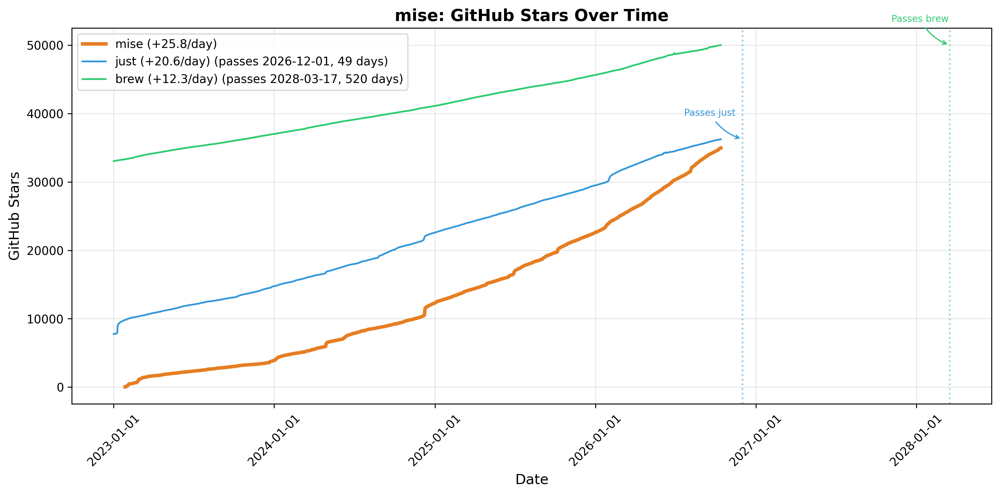
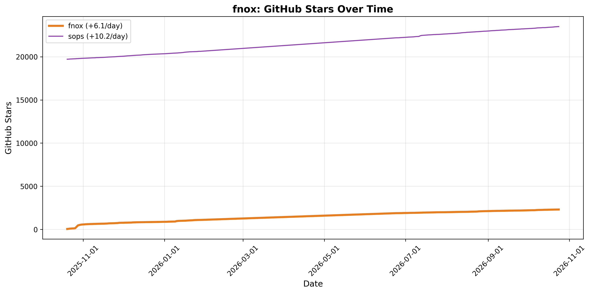
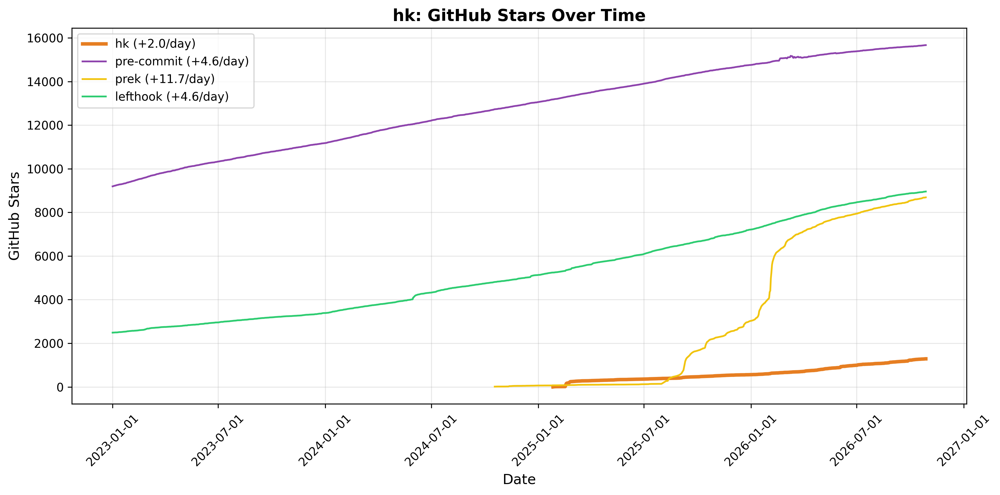
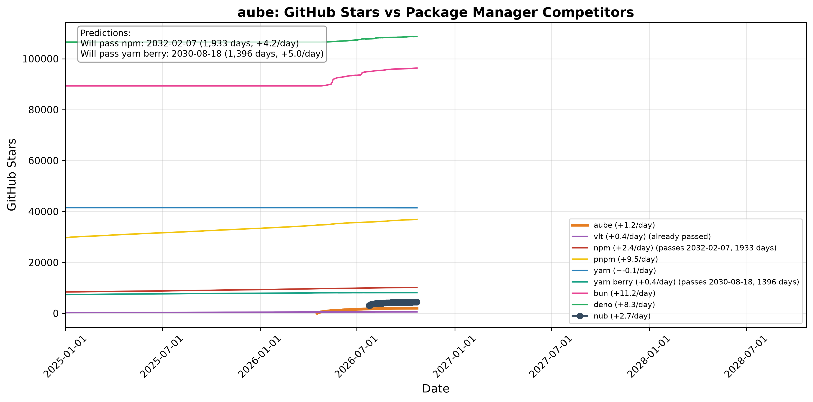
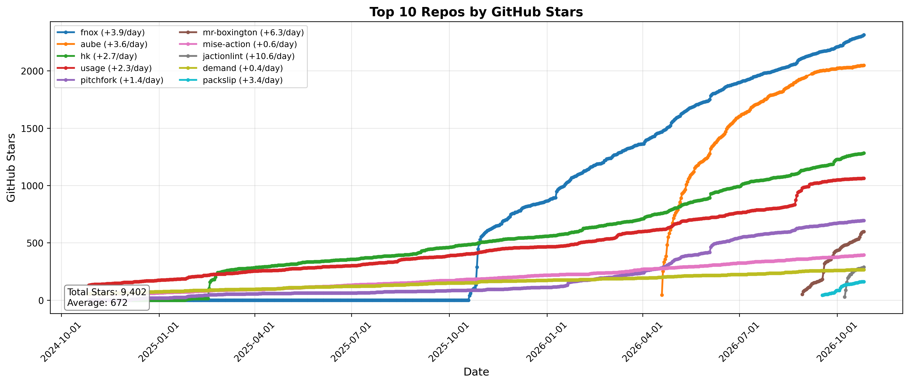
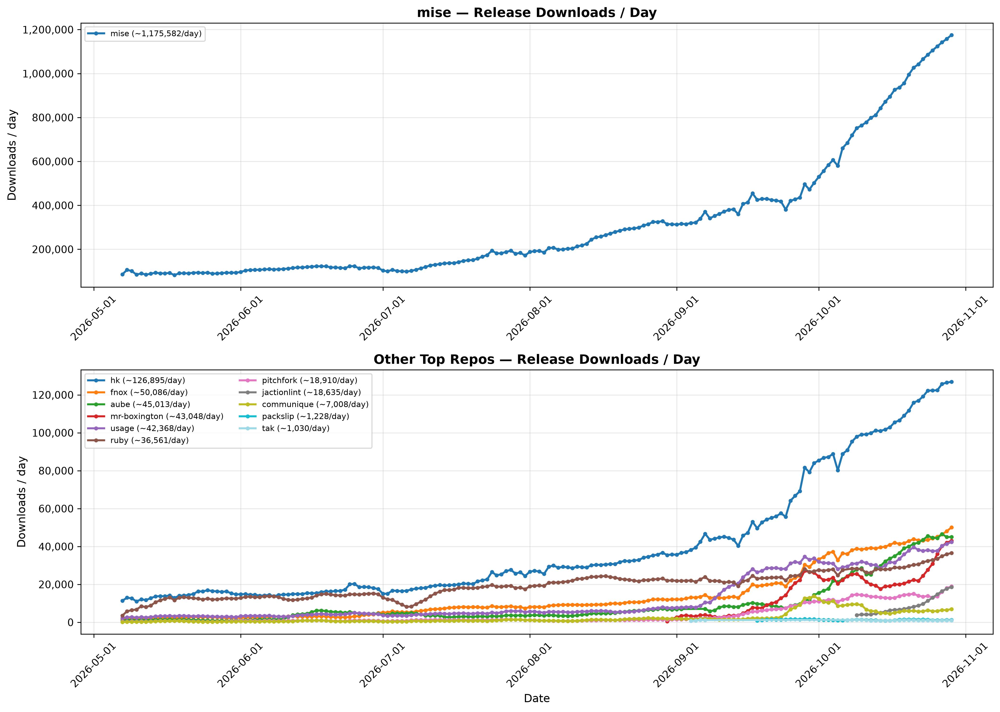
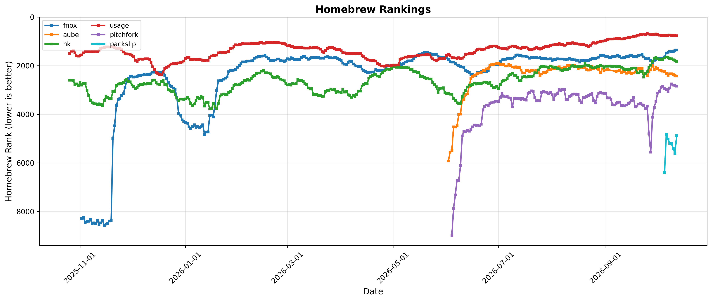
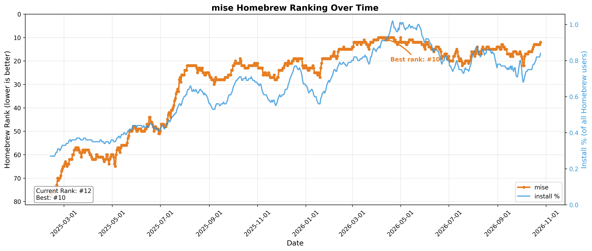

# mise Analytics

## Upcoming Crossovers

<!-- START upcoming-crossovers -->

| Project | Competitor | Expected Crossover | Days Until | lead gain (stars/day) |
| --- | --- | --- | --- | --- |
| mise | just | 2026-12-01 | 47 | 27.1 |
| mise | brew | 2028-03-05 | 507 | 30.3 |
| aube | berry | 2030-02-11 | 1215 | 5.8 |
| aube | npm | 2031-01-11 | 1548 | 5.3 |

<!-- END upcoming-crossovers -->

## mise Stats

## fnox Stats

## hk Stats

## aube Stats

## Top Repos Stats

## Top Repos Downloads

## Homebrew Rankings

## mise Homebrew Ranking

## Fastest Growing jdx Repos (30 Days)

<!-- START fastest-growing -->

Data window: 2026-09-16 → 2026-10-15 (UTC)

| Date | mise | mr-boxington | jactionlint | fnox | packslip |
| --- | --- | --- | --- | --- | --- |
| 2026-09-16 | 33,970 | 174 | — | 2,167 | — |
| 2026-09-17 | 34,013 (+43) | 182 (+8) | — | 2,170 (+3) | 43 |
| 2026-09-18 | 34,059 (+46) | 244 (+62) | — | 2,172 (+2) | 45 (+2) |
| 2026-09-19 | 34,083 (+24) | 318 (+74) | — | 2,173 (+1) | 49 (+4) |
| 2026-09-20 | 34,110 (+27) | 329 (+11) | — | 2,174 (+1) | 50 (+1) |
| 2026-09-21 | 34,153 (+43) | 336 (+7) | — | 2,176 (+2) | 51 (+1) |
| 2026-09-22 | 34,181 (+28) | 339 (+3) | — | 2,180 (+4) | 51 (+0) |
| 2026-09-23 | 34,216 (+35) | 346 (+7) | — | 2,180 (+0) | 54 (+3) |
| 2026-09-24 | 34,241 (+25) | 351 (+5) | — | 2,181 (+1) | 59 (+5) |
| 2026-09-25 | 34,272 (+31) | 354 (+3) | — | 2,187 (+6) | 59 (+0) |
| 2026-09-26 | 34,302 (+30) | 372 (+18) | — | 2,190 (+3) | 61 (+2) |
| 2026-09-27 | 34,329 (+27) | 386 (+14) | — | 2,191 (+1) | 61 (+0) |
| 2026-09-28 | 34,361 (+32) | 413 (+27) | — | 2,194 (+3) | 63 (+2) |
| 2026-09-29 | 34,413 (+52) | 424 (+11) | — | 2,202 (+8) | 74 (+11) |
| 2026-09-30 | 34,452 (+39) | 431 (+7) | — | 2,207 (+5) | 83 (+9) |
| 2026-10-01 | 34,478 (+26) | 435 (+4) | — | 2,210 (+3) | 84 (+1) |
| 2026-10-02 | 34,500 (+22) | 436 (+1) | — | 2,212 (+2) | 84 (+0) |
| 2026-10-03 | 34,540 (+40) | 440 (+4) | — | 2,216 (+4) | 85 (+1) |
| 2026-10-04 | 34,572 (+32) | 453 (+13) | — | 2,220 (+4) | 105 (+20) |
| 2026-10-05 | 34,595 (+23) | 463 (+10) | — | 2,219 (-1) | 118 (+13) |
| 2026-10-06 | 34,638 (+43) | 471 (+8) | — | 2,222 (+3) | 122 (+4) |
| 2026-10-07 | 34,679 (+41) | 476 (+5) | — | 2,238 (+16) | 128 (+6) |
| 2026-10-08 | 34,760 (+81) | 479 (+3) | 27 | 2,243 (+5) | 131 (+3) |
| 2026-10-09 | 34,807 (+47) | 481 (+2) | 87 (+60) | 2,250 (+7) | 136 (+5) |
| 2026-10-10 | 34,862 (+55) | 483 (+2) | 155 (+68) | 2,254 (+4) | 136 (+0) |
| 2026-10-11 | 34,895 (+33) | 488 (+5) | 193 (+38) | 2,257 (+3) | 137 (+1) |
| 2026-10-12 | 34,927 (+32) | 494 (+6) | 207 (+14) | 2,261 (+4) | 137 (+0) |
| 2026-10-13 | 34,952 (+25) | 503 (+9) | 222 (+15) | 2,270 (+9) | 139 (+2) |
| 2026-10-14 | 34,981 (+29) | 505 (+2) | 226 (+4) | 2,273 (+3) | 139 (+0) |
| 2026-10-15 | 35,024 (+43) | 508 (+3) | 241 (+15) | 2,277 (+4) | 142 (+3) |

- `mise` grew by +1,054 stars
- `mr-boxington` grew by +334 stars
- `jactionlint` grew by +214 stars
- `fnox` grew by +110 stars
- `packslip` grew by +99 stars

<!-- END fastest-growing -->
