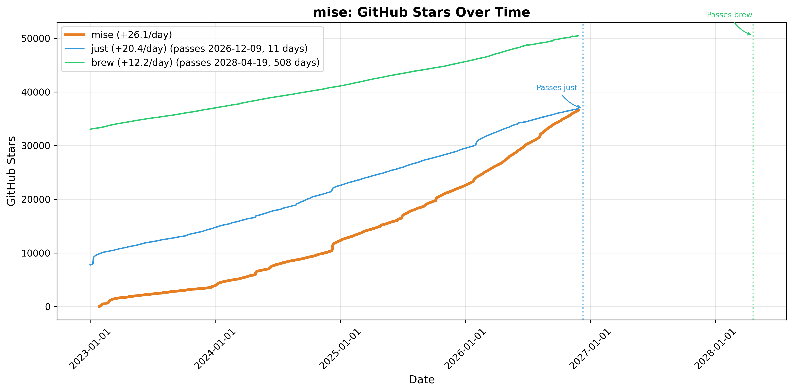
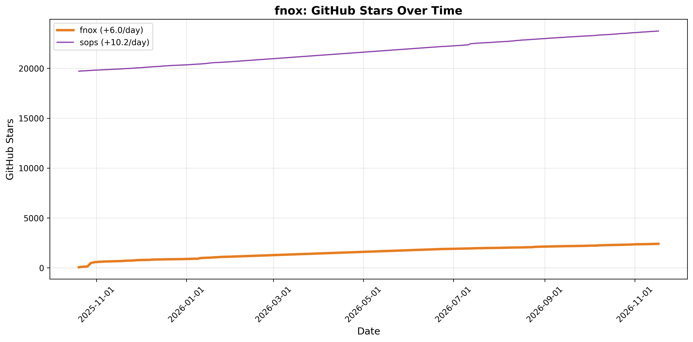
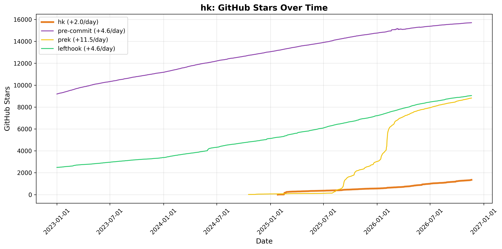
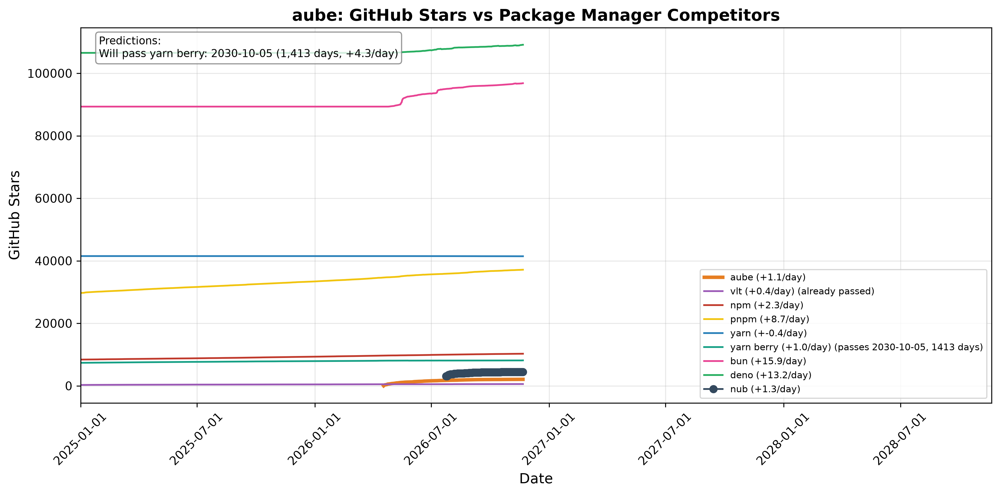
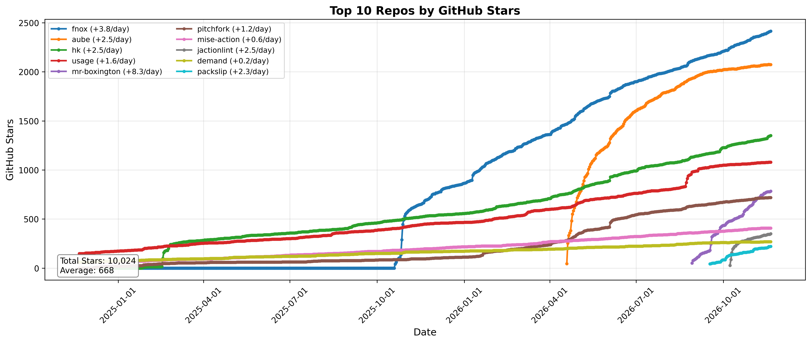
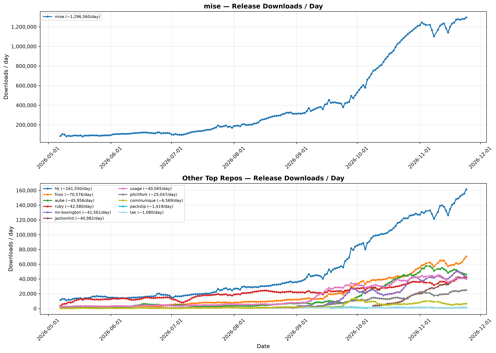

# mise Analytics

## Upcoming Crossovers

<!-- START upcoming-crossovers -->

| Project | Competitor | Expected Crossover | Days Until | lead gain (stars/day) |
| --- | --- | --- | --- | --- |
| mise | just | 2026-12-10 | 11 | 24.3 |
| mise | brew | 2028-04-21 | 509 | 27.5 |
| aube | berry | 2031-04-15 | 1598 | 3.8 |

<!-- END upcoming-crossovers -->

## mise Stats

## fnox Stats

## hk Stats

## aube Stats

## Top Repos Stats

## Top Repos Downloads

## Homebrew Rankings

## mise Homebrew Ranking

## Fastest Growing jdx Repos (30 Days)

<!-- START fastest-growing -->

Data window: 2026-10-30 → 2026-11-28 (UTC)

| Date | mise | mr-boxington | fnox | hk | jactionlint |
| --- | --- | --- | --- | --- | --- |
| 2026-10-30 | 35,555 | 636 | 2,336 | 1,292 | 298 |
| 2026-10-31 | 35,576 (+21) | 641 (+5) | 2,342 (+6) | 1,293 (+1) | 302 (+4) |
| 2026-11-01 | 35,601 (+25) | 652 (+11) | 2,345 (+3) | 1,294 (+1) | 304 (+2) |
| 2026-11-02 | 35,678 (+77) | 671 (+19) | 2,353 (+8) | 1,297 (+3) | 308 (+4) |
| 2026-11-03 | 35,718 (+40) | 681 (+10) | 2,354 (+1) | 1,299 (+2) | 311 (+3) |
| 2026-11-04 | 35,766 (+48) | 688 (+7) | 2,357 (+3) | 1,301 (+2) | 312 (+1) |
| 2026-11-05 | 35,812 (+46) | 700 (+12) | 2,359 (+2) | 1,302 (+1) | 314 (+2) |
| 2026-11-06 | 35,857 (+45) | 712 (+12) | 2,361 (+2) | 1,303 (+1) | 316 (+2) |
| 2026-11-07 | 35,894 (+37) | 714 (+2) | 2,361 (+0) | 1,304 (+1) | 317 (+1) |
| 2026-11-08 | 35,930 (+36) | 718 (+4) | 2,365 (+4) | 1,306 (+2) | 318 (+1) |
| 2026-11-09 | 35,968 (+38) | 730 (+12) | 2,369 (+4) | 1,308 (+2) | 321 (+3) |
| 2026-11-10 | 36,005 (+37) | 743 (+13) | 2,373 (+4) | 1,310 (+2) | 324 (+3) |
| 2026-11-11 | 36,041 (+36) | 745 (+2) | 2,379 (+6) | 1,312 (+2) | 328 (+4) |
| 2026-11-12 | 36,075 (+34) | 751 (+6) | 2,379 (+0) | 1,313 (+1) | 332 (+4) |
| 2026-11-13 | 36,102 (+27) | 762 (+11) | 2,385 (+6) | 1,316 (+3) | 336 (+4) |
| 2026-11-14 | 36,135 (+33) | 765 (+3) | 2,387 (+2) | 1,317 (+1) | 335 (-1) |
| 2026-11-15 | 36,173 (+38) | 772 (+7) | 2,390 (+3) | 1,319 (+2) | 337 (+2) |
| 2026-11-16 | 36,212 (+39) | 776 (+4) | 2,397 (+7) | 1,321 (+2) | 340 (+3) |
| 2026-11-17 | 36,242 (+30) | 778 (+2) | 2,402 (+5) | 1,337 (+16) | 344 (+4) |
| 2026-11-18 | 36,284 (+42) | 779 (+1) | 2,407 (+5) | 1,343 (+6) | 345 (+1) |
| 2026-11-19 | 36,291 (+7) | 779 (+0) | 2,410 (+3) | 1,346 (+3) | 345 (+0) |
| 2026-11-20 | 36,347 (+56) | 783 (+4) | 2,415 (+5) | 1,350 (+4) | 350 (+5) |
| 2026-11-21 | 36,368 (+21) | 785 (+2) | 2,416 (+1) | 1,352 (+2) | 351 (+1) |
| 2026-11-22 | 36,392 (+24) | 785 (+0) | 2,415 (-1) | 1,353 (+1) | 352 (+1) |
| 2026-11-23 | 36,428 (+36) | 788 (+3) | 2,418 (+3) | 1,354 (+1) | 354 (+2) |
| 2026-11-24 | 36,469 (+41) | 791 (+3) | 2,420 (+2) | 1,356 (+2) | 359 (+5) |
| 2026-11-25 | 36,517 (+48) | 810 (+19) | 2,422 (+2) | 1,361 (+5) | 360 (+1) |
| 2026-11-26 | 36,547 (+30) | 821 (+11) | 2,426 (+4) | 1,363 (+2) | 360 (+0) |
| 2026-11-27 | 36,578 (+31) | 824 (+3) | 2,430 (+4) | 1,364 (+1) | 361 (+1) |
| 2026-11-28 | 36,593 (+15) | 831 (+7) | 2,431 (+1) | 1,364 (+0) | 364 (+3) |

- `mise` grew by +1,038 stars
- `mr-boxington` grew by +195 stars
- `fnox` grew by +95 stars
- `hk` grew by +72 stars
- `jactionlint` grew by +66 stars

<!-- END fastest-growing -->
